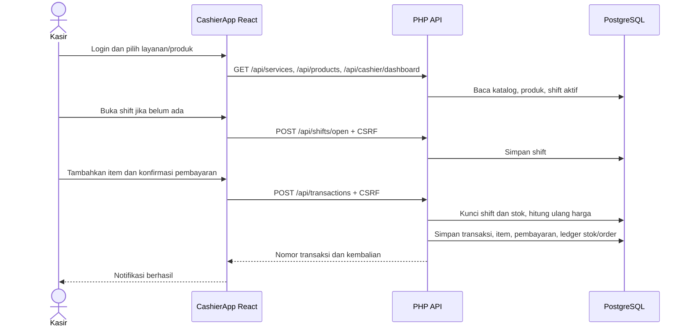
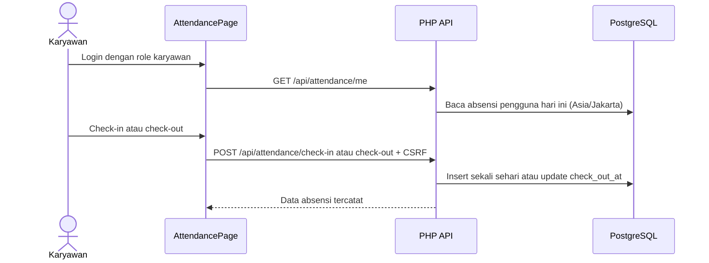

# Arsitektur dan Alur Fitur KINO Laundry POS

Dokumen ini menggambarkan implementasi yang ada pada kode sumber proyek, bukan rancangan fitur mendatang. Bagian yang masih berupa data prototipe atau memiliki keterbatasan ditandai secara eksplisit.

## 1. Ringkasan teknologi

| Lapisan | Teknologi dan lokasi |
|---|---|
| Frontend | React 18, JSX, JavaScript, Vite, Tailwind CSS v4 melalui plugin Vite |
| UI | Komponen React per role, `lucide-react`, CSS proyek di `src/` |
| Backend | PHP 8.1+ dengan satu front controller di `api/public/index.php` |
| Database | PostgreSQL melalui PDO dan ekstensi `pdo_pgsql` |
| Autentikasi | Session PHP berbasis cookie, password hash, pemeriksaan role, dan token CSRF |
| Komunikasi lokal | Vite meneruskan path `/api` ke server PHP di `127.0.0.1:8000` |

Entry HTML adalah `index.html`; entry Vite adalah `src/main.jsx`, yang merender root aplikasi di `src/app/Root.jsx`. Tidak ditemukan React Router. Path seperti `/owner` dan `/kasir` hanya ditulis ke browser history setelah login; pemilihan halaman dilakukan oleh state React dan role pengguna.

## 2. Struktur folder sumber

```text
api/
  bootstrap.php                 # Konfigurasi environment, PDO, session helper, CSRF, respons JSON
  public/
    index.php                   # Front controller dan semua endpoint API
  scripts/
    create_user.php             # Pembuatan satu akun melalui prompt CLI
    create_initial_accounts.php # Pembuatan akun Owner, Kasir, dan Karyawan dengan password acak

database/
  schema.sql                    # Tabel, constraint, indeks, outlet awal, jenis koin awal
  seed.sql                      # Katalog layanan dan tarif malam yang tercantum di seed

src/
  main.jsx                      # Entry Vite dan pemuat stylesheet berurutan
  app/
    Root.jsx                    # Pemulihan sesi dan pemilihan halaman berdasarkan role
  shared/
    api.js                      # Fetch JSON, cookie credentials, token CSRF, error API
    styles/                     # Entry dan tipografi lintas fitur
  features/
    auth/
      LoginPage.jsx             # Login bersama
    owner/
      components/               # OwnerPortal, OwnerDashboard, OwnerModule, AttendanceAdmin
      styles/                   # Shell, dashboard, dan motion Owner
    employee/
      components/               # AttendancePage
    cashier/
      CashierApp.jsx            # Shell POS, katalog, keranjang, pembayaran, navigasi Kasir
      components/               # Halaman operasional Kasir
      data/                     # Katalog UI dan data mock Kasir
      styles/                   # Halaman dan redesign Kasir
  style.css                     # Gaya dasar lintas halaman
```

Komponen `OwnerLogin.jsx` masih ada di `src/features/owner/components/`, tetapi entry aplikasi menggunakan `src/features/auth/LoginPage.jsx`; autentikasi Owner aktual memakai login bersama yang sama.

## 3. Routing frontend dan akses role

Saat aplikasi dimuat, `Root` di `src/app/Root.jsx` meminta `/api/auth/me`.

1. Selama pemeriksaan sesi, frontend menampilkan status pemuatan.
2. Jika tidak ada sesi, frontend menampilkan `LoginPage`.
3. Jika role `owner`, aplikasi menampilkan `OwnerPortal`.
4. Jika role `karyawan`, aplikasi menampilkan `AttendancePage`.
5. Role lainnya diarahkan ke `CashierApp`; operasi Kasir di backend secara khusus mensyaratkan role `kasir`.

Navigasi dalam Owner dan Kasir mengubah state menu aktif, bukan URL route. API tetap melakukan pemeriksaan role sendiri; menyembunyikan atau menampilkan halaman di frontend bukan pengganti otorisasi server.

| Role | Halaman utama | Kemampuan backend yang terlihat |
|---|---|---|
| Owner | Dashboard, laporan keuangan, manajemen karyawan & shift (tampilan absensi), manajemen harga & promo, integrasi, pengaturan bisnis | Ringkasan/laporan Owner, daftar absensi, daftar dan perubahan tarif, baca dan ubah profil outlet |
| Kasir | POS, dashboard, pesanan, histori, stok, koin, laporan shift, pengaturan, bantuan | Baca katalog/produk, dashboard shift, buka/tutup shift, buat transaksi |
| Karyawan | Absensi hari ini | Baca, check-in, dan check-out absensi sendiri |

## 4. API backend

Semua endpoint ditangani oleh `api/public/index.php` dengan pencocokan method dan path. Respons berbentuk JSON. Error autentikasi menggunakan HTTP 401, role yang tidak sesuai 403, dan input tidak valid umumnya 422.

### Autentikasi

| Method dan path | Akses | Fungsi |
|---|---|---|
| `GET /api/auth/csrf` | Publik | Membuat atau mengembalikan token CSRF sesi |
| `POST /api/auth/login` | Publik + CSRF | Mencari username/email aktif, memverifikasi password hash, merotasi session ID |
| `GET /api/auth/me` | Sesi opsional | Mengembalikan pengguna aktif pada sesi, atau `user: null` |
| `POST /api/auth/logout` | Sesi + CSRF | Menghapus data sesi dan menutup session |

Cookie sesi dikonfigurasi `HttpOnly`, `SameSite=Lax`, path `/`, dan `Secure` ketika koneksi HTTPS terdeteksi. Endpoint mutasi yang terhubung ke frontend menggunakan header `X-CSRF-Token`.

### POS dan shift Kasir

| Method dan path | Akses | Fungsi |
|---|---|---|
| `GET /api/services` | Kasir | Membaca layanan aktif dan memilih harga malam ketika jam Asia/Jakarta berada pada rentang 23:00–05:59 |
| `GET /api/products` | Kasir | Membaca produk aktif |
| `GET /api/cashier/dashboard` | Kasir | Membaca shift terbuka milik Kasir dan total transaksi pada shift |
| `POST /api/shifts/open` | Kasir + CSRF | Membuka shift `pagi`, `siang`, atau `malam`; menolak shift kedua yang masih terbuka |
| `POST /api/shifts/close` | Kasir + CSRF | Menghitung pembayaran shift dan menandainya ditutup |
| `POST /api/transactions` | Kasir + CSRF | Memvalidasi item, menghitung harga di server, mencatat transaksi/pembayaran, dan mengurangi stok produk |

### Absensi

| Method dan path | Akses | Fungsi |
|---|---|---|
| `GET /api/attendance/me` | Sesi aktif | Membaca absensi pengguna untuk tanggal hari ini di Asia/Jakarta |
| `POST /api/attendance/check-in` | Sesi aktif + CSRF | Mencatat check-in sekali per pengguna per hari |
| `POST /api/attendance/check-out` | Sesi aktif + CSRF | Mengisi check-out bila absensi hari ini masih terbuka |
| `GET /api/attendance` | Owner | Membaca daftar akun aktif Kasir/Karyawan dengan filter tanggal, nama, dan shift |

Endpoint GET absensi Owner menggabungkan daftar pengguna aktif dengan absensi tanggal yang dipilih, sehingga akun yang belum check-in tetap dapat ditampilkan. Filter shift bergantung pada `employee_attendance.shift_id`; endpoint check-in yang ada tidak mengisi kolom tersebut.

### Owner

| Method dan path | Akses | Fungsi |
|---|---|---|
| `GET /api/owner/dashboard` | Owner | Ringkasan pendapatan transaksi lunas, pembayaran, status pesanan, grafik harian, transaksi terbaru, kehadiran, dan layanan teratas |
| `GET /api/owner/finance` | Owner | Daftar transaksi dan total dengan filter periode, metode bayar, status pembayaran, dan pencarian; maksimal 200 baris dikembalikan |
| `GET /api/owner/services` | Owner | Membaca tarif layanan dan tarif malam aktif |
| `PUT /api/owner/services/price` | Owner + CSRF | Mengubah harga normal dan opsional harga malam |
| `GET /api/owner/outlet` | Owner | Membaca outlet aktif pertama |
| `PUT /api/owner/outlet` | Owner + CSRF | Mengubah nama, alamat, dan nomor telepon outlet aktif pertama |

Periode Owner menerima `today`, `7days`, `month`, `quarter`, dan `custom` dengan tanggal `from`/`to`. Ringkasan pengeluaran tidak tersedia; API secara eksplisit mengembalikan `expenses_available: false`.

## 5. Skema dan relasi database

`database/schema.sql` membuat 17 tabel pada schema `public`:

| Kelompok | Tabel | Peran data |
|---|---|---|
| Identitas | `outlets`, `users` | Outlet dan akun Owner/Kasir/Karyawan |
| Shift dan absensi | `shifts`, `employee_attendance` | Shift kerja, check-in/out, status kehadiran |
| Katalog | `services`, `service_prices`, `products` | Tarif layanan, tarif malam, dan produk/stok |
| Transaksi | `customers`, `transactions`, `transaction_items`, `payments` | Header transaksi, item, pelanggan, dan pembayaran |
| Laundry/logistik | `laundry_orders`, `deliveries` | Status pesanan laundry dan data pengiriman |
| Koin dan inventaris | `coin_types`, `coin_movements`, `inventory_movements` | Stok/pergerakan koin serta riwayat stok produk |
| Sinkronisasi | `sync_jobs` | Struktur pencatatan pekerjaan sinkronisasi |

Relasi transaksi utama:

```text
outlets ──< users ──< shifts
   │          │          │
   │          ├──< employee_attendance
   │          └──< transactions >── customers
   │                    │
   │                    ├──< transaction_items >── services
   │                    │                       └── products
   │                    ├── payments
   │                    └── laundry_orders ── deliveries
   └────────────────────┘

products ──< inventory_movements
coin_types ──< coin_movements >── shifts / transactions
```

Skema menerapkan foreign key, check constraint untuk role/status/nilai, unique username/email tanpa membedakan kapital, maksimal satu shift terbuka per pengguna, dan satu pembayaran per transaksi.

### Data awal dari berkas SQL

- `schema.sql` membuat satu outlet bernama `KINO Laundry` jika tabel outlet belum berisi data.
- `schema.sql` juga membuat dua jenis koin awal jika belum ada.
- `seed.sql` menambahkan layanan dan harga malam tertentu dengan `ON CONFLICT DO NOTHING`.
- `seed.sql` tidak menambahkan produk, pelanggan, akun, transaksi, atau absensi.
- Isi database aktual tidak ditentukan oleh dokumentasi ini; file SQL menunjukkan hanya apa yang akan disisipkan ketika dijalankan.

## 6. Alur transaksi Kasir



Urutan pada endpoint transaksi:

1. Memastikan akun Kasir terhubung ke outlet, daftar item tersedia, dan metode bayar `tunai` atau `qris`.
2. Memulai transaksi PostgreSQL dan mengunci shift terbuka milik Kasir.
3. Memvalidasi jumlah item (lebih dari 0 dan tidak lebih dari 10.000).
4. Membaca harga layanan dari database pada waktu transaksi; produk dibaca dengan row lock dan stok diperiksa.
5. Memastikan uang tunai yang diterima cukup.
6. Menyisipkan transaksi dan item. Untuk produk, stok dikurangi dan baris `inventory_movements` bertipe `keluar` dibuat.
7. Membuat pembayaran, dan membuat `laundry_orders` generik bila tipe transaksi adalah `drop_off`.
8. Commit transaksi dan mengembalikan nomor transaksi serta kembalian tunai.

### Batasan alur transaksi yang tampak di kode

- UI QRIS menggambar pola QR statis. Backend hanya mencatat metode `qris`; tidak ada gateway atau verifikasi pembayaran eksternal.
- Backend selalu menyimpan transaksi baru dengan status pembayaran `lunas`, termasuk ketika metode QRIS dipilih.
- Backend hanya menerjemahkan tipe kiriman `drop_off`; tipe lain disimpan sebagai `self_service`, termasuk transaksi produk.
- Form Drop Off menampilkan nama, nomor telepon, berat, dan jumlah mesin, tetapi payload transaksi yang dikirim tidak menyertakan nilai tersebut. Endpoint membuat pesanan laundry tanpa menghubungkan pelanggan atau berat.
- Data contoh nama/nota, ringkasan Kasir, mesin, transaksi terakhir, dan sebagian navigasi POS masih statis.
- Tidak ada endpoint GET transaksi untuk halaman histori Kasir; `TransactionHistory`, `OrderManagement`, `InventoryManagement`, `CoinManagement`, dan `ShiftReports` mengimpor data mock. Perubahan pada layar tersebut tidak menjadi data persisten.
- Endpoint menutup shift tersedia, tetapi alur UI Kasir yang ditinjau tidak memanggil `/api/shifts/close`.

## 7. Alur absensi



Owner dapat melihat data melalui `AttendanceAdmin`; endpoint tidak menyediakan mutasi absensi Owner. Constraint database memastikan satu baris per pengguna per tanggal dan waktu pulang tidak lebih awal dari waktu masuk.

## 8. Peta persistensi halaman

| Halaman/fitur | Sumber data saat ini | Persistensi |
|---|---|---|
| Login dan sesi | `users`, session PHP | PostgreSQL + session |
| POS: katalog layanan | `/api/services`, harga dihitung ulang di backend saat transaksi | PostgreSQL |
| POS: produk | `/api/products` | PostgreSQL jika produk sudah dimasukkan |
| Pembuatan transaksi | `/api/transactions` | PostgreSQL |
| Buka/tutup shift | `/api/shifts/open`, `/api/shifts/close` | PostgreSQL; sebelum tutup Kasir mengonfirmasi jenis dan ID sesi aktif, lalu server memverifikasi ID sesi tersebut |
| Absensi Karyawan | `/api/attendance/me` dan endpoint check-in/out | PostgreSQL |
| Dashboard Owner | `/api/owner/dashboard` | Query PostgreSQL; pesanan agregat tidak memakai filter periode |
| Laporan Owner | `/api/owner/finance` | Query PostgreSQL; daftar dibatasi 200 baris |
| Tarif Owner | `/api/owner/services`, `/api/owner/services/price` | PostgreSQL |
| Profil outlet Owner | `/api/owner/outlet` | PostgreSQL |
| Promo dan Google Sheets | Belum ada tabel/endpoint yang digunakan UI | Belum tersedia |
| Pengeluaran dan laba | Tidak ada skema pengeluaran | Tidak dihitung |
| Histori/pesanan/stok/koin/laporan Kasir | Data di `src/features/cashier/data/` dan state komponen | Mock/state browser; bukan persistensi backend |

## 9. Konfigurasi dan cara menjalankan

`api/bootstrap.php` membaca `.env` di root proyek, lalu membuat koneksi PDO PostgreSQL. Nilai konfigurasi yang dibaca mencakup `DB_HOST`, `DB_PORT`, `DB_NAME`, `DB_USER`, `DB_PASSWORD`, `APP_TIMEZONE`, `APP_SESSION_NAME`, dan `APP_ENV`. Jangan menaruh nilai rahasia aktual di dokumentasi atau frontend.

Petunjuk perintah pengembangan dan persiapan lokal dipelihara di [`README-backend.md`](../README-backend.md). Untuk konfigurasi lokal, sesuaikan nama database dan kredensial dengan database yang memang digunakan di mesin Anda.

Skrip akun:

- `api/scripts/create_user.php` meminta satu akun melalui CLI. Peran non-Owner membutuhkan outlet aktif.
- `api/scripts/create_initial_accounts.php` mencoba membuat tiga akun dan menampilkan password acak satu kali; skrip ini memerlukan tabel dan outlet aktif.

## 10. Batas cakupan dokumen

Dokumen ini ditulis dari pembacaan file sumber. Tidak ada query ke PostgreSQL yang dijalankan untuk penyusunan dokumen ini, sehingga status maupun jumlah data aktual tidak dinyatakan. Tidak ada kode aplikasi atau database yang diubah.
